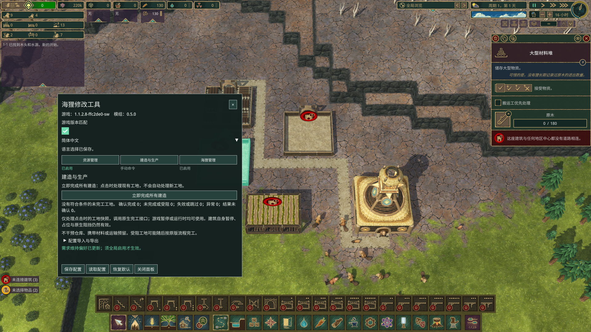
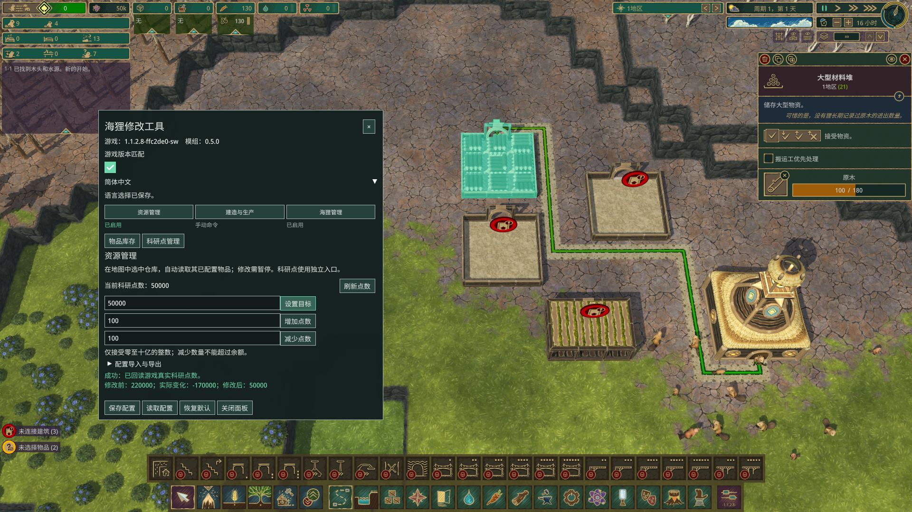
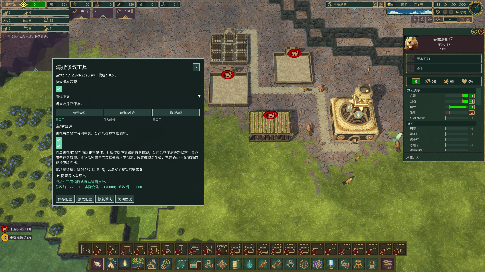

# Timberborn Trainer

[简体中文](README.zh-CN.md) · [English guide](docs/Usage.en.md) · [中文使用说明](docs/使用说明.md)

**Version: v0.6.0**

A lightweight floating trainer for **Resource Management**, **Building & Production**, and **Beaver Management**. One shared DLL now supports runtime English and Simplified Chinese through external JSON language files.

Download the [unified v0.6.0 package](https://github.com/crayonmmn/TimberbornTrainer/releases/download/v0.6.0/TimberbornTrainer-v0.6.0-win64.zip) from [GitHub Releases](https://github.com/crayonmmn/TimberbornTrainer/releases/latest). [SHA256 checksums](https://github.com/crayonmmn/TimberbornTrainer/releases/download/v0.6.0/SHA256SUMS.txt). Historical v0.5.0 and v0.4.0 releases remain available.

## Features

- **Resource Management:** select a completed supported warehouse on the map, read its configured item and add/remove stock, including an empty warehouse with an assigned item. Native capacity, reservations, identity checks, global enable and manual pause remain required. Unsupported targets remain read-only. Science has a separate page with read, add, subtract and set operations.
- **Building & Production:** **Finish all construction** processes eligible current sites once using the native API. It does not auto-complete future sites, override building pause/blockers or add production multipliers. Native logistics handles materials.
- **Beaver Management:** independently maintain basic hunger and thirst. Other nutrition needs are not locked; started eating/drinking actions are not forcibly cancelled. Turning maintenance off restores native updating.
- Movable floating window, left/right docking, delayed edge hiding, independent edge-tab gestures and existing keyboard behavior remain in place.

## Feature screenshots

User-provided v0.5.0 in-game captures from2026-11-16, shown without cropping or content edits. All four show the Simplified Chinese interface; the English descriptions below identify the same features available in either language. The language selector is visible; these are not English-interface captures.

### One-shot construction

Finish eligible current construction sites once through the native game mechanism.



### Warehouse inventory

Read the selected warehouse, configured item, current stock and unreserved limits before editing.


### Science points

Read, set, add or subtract science points with native read-back feedback.



### Beaver hunger and thirst

Control basic hunger and thirst independently while leaving other needs to the game.



## Installation and language

**Local manual-install directory (Windows)**

- Default: `%USERPROFILE%\Documents\Timberborn\Mods\TimberbornTrainer\`
- If Documents is redirected to OneDrive, use its actual location, for example `%OneDrive%\Documents\Timberborn\Mods\TimberbornTrainer\`. The folder name and drive may differ on your PC.
- To find the correct location, open **Documents** in File Explorer and then `Timberborn\Mods`. The game's Mod Manager also provides **Browse local mods**. Use that folder rather than guessing a drive or username.

Extract the ZIP's `TimberbornTrainer` folder into `Mods`, so `manifest.json` is directly at `Mods\TimberbornTrainer\manifest.json`. Avoid `Mods\TimberbornTrainer\TimberbornTrainer\` nesting. This is the **user Mod folder**, not the Steam game installation folder or `Timberborn_Data\Managed`. If using the Workshop copy, do not also keep a manual copy with the same Mod ID.

Verified baseline: Steam Timberborn **1.1.2.8-ffc2de0-sw**, Unity **6000.5.11f1**, Mono, Windows64. Uses the official mod loader; **no BepInEx, Harmony, extra Mod, Unity Editor or development SDK is required**. Other game/Unity versions and interface checks warn rather than disabling features; actual calls can fail. Windows64 and original business safety conditions remain. Compatibility with every third-party Mod is not guaranteed.

For v0.6.0, use `TimberbornTrainer-v0.6.0-win64.zip`. Exit the game, back up saves and the old Mod folder, and replace the complete folder in your actual Documents directory (which may be redirected to OneDrive):

```text
Timberborn/Mods/TimberbornTrainer/
  TimberbornTrainer.dll
  manifest.json
  Languages/en-US.json
  Languages/zh-CN.json
  ...README, guides and license notices
```

Keep the **Languages** folder beside the DLL. Do not mix v0.4.0 language DLLs or install another copy of Mod ID `TimberbornTrainer.Core`. Do not copy files into the game's Managed folder. Enable the Mod in the official manager.

Language selection is manual only. With no valid saved preference, the interface starts in English. Use **Language / 语言** to select **English** or **简体中文**. Existing `en-US`/`zh-CN` preferences are retained; missing, corrupt or invalid preferences safely default to English. A manual choice is saved immediately to `%LOCALAPPDATA%/TimberbornTrainer/language.json`. A save failure is reported and the session choice remains usable. Language does not follow the game's language and is separate from gameplay configuration and savegames.

**Enable global changes** permits editing commands and selected hunger/thirst maintenance. Reading remains available while off; inventory editing also requires pausing the game. Switching languages does not change this switch.

Text updates in place, including cached results and errors; gameplay state, input values, window/tab position and native item names are preserved. Missing Chinese keys fall back to English, then to another available pack or safe fallback text. Missing/corrupt language files cannot block startup; restore the original two JSON files from the unified package. [Full guide](docs/Usage.en.md).

## Validation and limitations

**The user reported successful in-game testing of the manual-language/UI fixes used for v0.6.0.** Both language regression contexts passed 755 assertions; localization/package checks passed 27, with 0 build errors/warnings. This is not exhaustive validation of all resolutions, saves, game versions or Mod combinations. See [acceptance record](docs/release/v0.6.0/acceptance.md). Historical v0.5.0 remains available.

## Build and tests

Use PowerShell7 with installed Roslyn and a legally installed matching game. No game DLL is distributed in this repository or package.

```powershell
./build/Build.ps1 -GamePath '<game root>'
./build/Test.ps1 -GamePath '<game root>' -Language en
./build/Test.ps1 -GamePath '<game root>' -Language zh-CN
./build/Test-Localization.ps1 -GamePath '<game root>'
```

Build.ps1 produces one DLL under `dist/unified/TimberbornTrainer` and copies external language resources. Build/Test support `-CompilerDirectory`; localization checks use Roslyn from `$PSHOME`. Tests regenerate their own output. The test language flag selects expectations; it does not produce different shipping DLLs.

## License, AI development and maintenance

Project-owned code is [MIT](LICENSE); retain copyright/license and applicable [third-party notices](THIRD_PARTY_NOTICES.md). Game/Unity/third-party rights are not relicensed by this project. [Source records](docs/第三方代码来源记录.md). The package contains no game DLLs or assets.

Development: This project was developed by the author with AI-assisted collaboration. The author directed the design, implementation, testing, and release process, with AI tools assisting in research, coding, debugging, documentation, and translation. It is a personal hobby project, not an official OpenAI release or supported by OpenAI. Automated and limited in-game testing cannot rule out undiscovered bugs, compatibility issues or save risks. **Back up important saves.**

**Provided AS IS, with no commitment to ongoing maintenance, bug fixes, technical support or future updates.** Future updates are entirely at the author's discretion. Existing license terms remain unchanged.

Forks, modifications, extensions, [Issues](https://github.com/crayonmmn/TimberbornTrainer/issues) and Pull Requests are welcome. Redistributors must follow the actual MIT license and notices. Fork maintainers are responsible for their own compatibility and maintenance; an open Issue does not create an obligation to respond or fix it.

欢迎Fork、二次开发、Issue和Pull Request。重新分发须遵守实际许可证并保留声明；修改版由修改者自行负责维护和兼容，原作者不承诺回复、修复或持续更新。

## Uninstall

Turn off continuous maintenance and the global switch, exit the game, then back up/remove only this Mod folder. Earlier world changes are not undone. Language/gameplay preferences may be retained or removed separately from LocalApplicationData/TimberbornTrainer; they are not save files.
