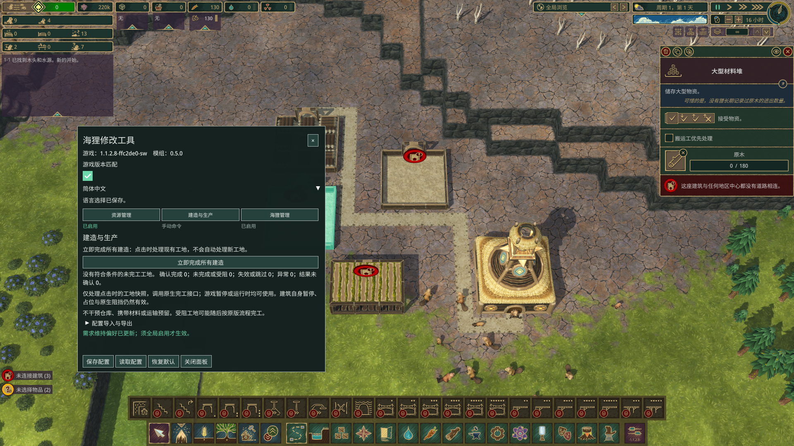
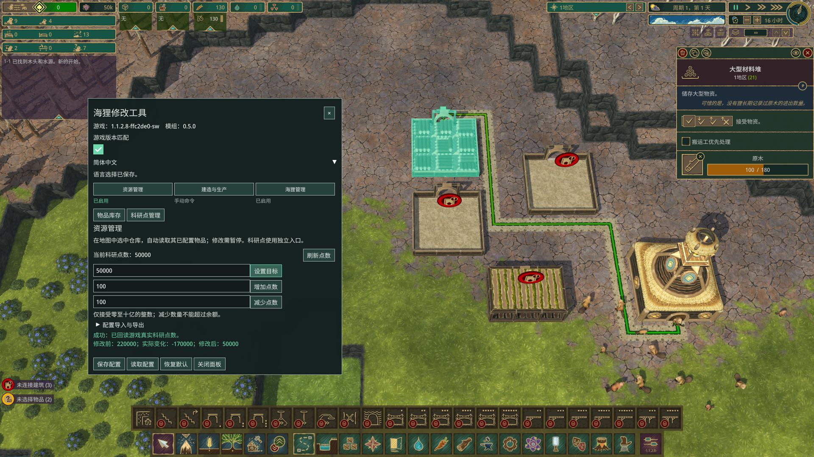
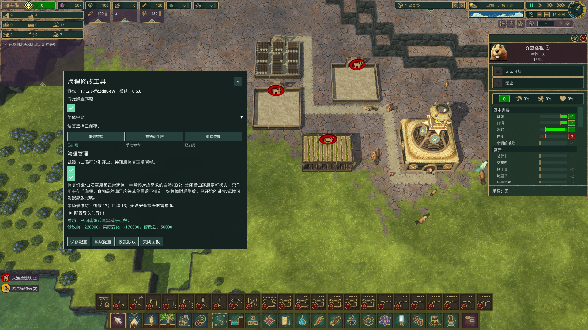

# Timberborn Trainer 海狸修改工具

[English](README.md) · [中文使用说明](docs/使用说明.md) · [English guide](docs/Usage.en.md)

**当前版本：v0.6.0**

轻量悬浮修改器，保留资源管理、建造与生产、海狸管理三个模块。现在使用一套DLL和外置JSON语言包，在游戏内切换English／简体中文。

下载[v0.6.0统一双语安装包](https://github.com/crayonmmn/TimberbornTrainer/releases/download/v0.6.0/TimberbornTrainer-v0.6.0-win64.zip)，见[最新Release](https://github.com/crayonmmn/TimberbornTrainer/releases/latest)和[SHA256清单](https://github.com/crayonmmn/TimberbornTrainer/releases/download/v0.6.0/SHA256SUMS.txt)。历史v0.4.0独立中英文包保留。

## 功能

- **资源管理：** 地图选中已完工的支持仓储，读取其已配置物品并增减数量；已指定物品的空仓库也可操作。保留原生容量、预留、身份、全局开关和手动暂停检查；不支持的库存只读。科研点有独立的读取、增加、减少、设置入口。
- **建造与生产：** “立即完成所有建造”仅处理点击时符合条件的工地，不自动处理新工地，不绕过建筑暂停／阻挡，不新增生产倍率。材料后续由原版物流处理。
- **海狸管理：** 分别维持基础饥饿与口渴，关闭后恢复原版更新。不锁定其他营养需求，不强制取消已经开始的进食饮水。
- 保留窗口拖动、左右吸附、靠边隐藏、独立边缘标签手势及原有键盘交互。

## 功能实机截图

以下为用户于2026-11-16提供的四张v0.5.0实机截图，均为简体中文界面，原样保留，未裁剪或修改内容。四个功能项分属现有三个业务模块；语言选择器可见，但本组不含英文界面截图。

### 一次性建造

通过原版机制一次性完成当前符合条件的工地。



### 仓库物品管理

读取地图选中仓库的配置物品、实际库存及未预留可操作量。


### 科研点管理

读取、设置、增加或减少科研点，并显示原生回读反馈。



### 海狸饥饿与口渴

分别维持基础饥饿与口渴，其他需求仍由游戏管理。



## 安装与语言

**Windows 本地手动安装目录**

- 默认位置：`%USERPROFILE%\Documents\Timberborn\Mods\TimberbornTrainer\`
- 如果“文档”已重定向到 OneDrive，请使用实际位置，例如 `%OneDrive%\Documents\Timberborn\Mods\TimberbornTrainer\`。不同电脑的盘符及文件夹名称可能不同。
- 查找方法：在文件资源管理器中打开 **“文档”**，再进入 `Timberborn\Mods`；也可在游戏 Mod Manager 中点击 **“浏览本地模组”**，以打开的目录为准，不要直接猜测盘符或用户名。

把 ZIP 中的 `TimberbornTrainer` 文件夹解压到 `Mods`，最终必须存在 `Mods\TimberbornTrainer\manifest.json`。避免多套一层 `Mods\TimberbornTrainer\TimberbornTrainer\`。这里是**用户 Mod 目录**，不是 Steam 游戏安装目录，也不是 `Timberborn_Data\Managed`。使用创意工坊订阅版时，不要再同时保留同 Mod ID 的手动安装副本。

已验证环境基准：Windows64、Steam Timberborn **1.1.2.8-ffc2de0-sw**、Unity **6000.5.11f1**、Mono。使用游戏官方Mod加载器，无需BepInEx、Harmony、其他Mod、Unity Editor或开发SDK。其他游戏／Unity版本及接口诊断只警告，不保证实际功能可用；Windows64平台与原有业务安全检查保留。不承诺兼容所有第三方Mod。

v0.6.0统一包为 `TimberbornTrainer-v0.6.0-win64.zip`。退出游戏、备份重要存档和旧Mod目录后，将完整文件夹放到实际“文档”目录的 `Timberborn/Mods/`（注意OneDrive重定向）：

```text
TimberbornTrainer/
  TimberbornTrainer.dll
  manifest.json
  Languages/en-US.json
  Languages/zh-CN.json
  ...README、使用说明与许可证
```

Languages必须保留在DLL旁。Mod ID仍为 `TimberbornTrainer.Core`，不能同时保留旧版中英文DLL或多份同ID安装。不要放入游戏Managed目录。通过官方管理器启用Mod。

仅手动选择语言，不再读取游戏语言。没有有效偏好时默认 English；在 **Language / 语言** 中选择 English 或简体中文。旧的 `en-US` / `zh-CN` 配置继续有效；配置缺失、损坏或值无效时安全回退英文。选择后立即保存到 `%LOCALAPPDATA%/TimberbornTrainer/language.json`，重启后恢复。保存失败会提示，本次会话仍可切换；不修改游戏存档或业务配置格式。

**启用全局修改**控制修改命令和已选择的饥饿／口渴维持。关闭时仍可读取信息，修改物品还需暂停游戏。语言切换不改变全局开关。

切换只刷新文字，包括已显示的结果和错误，不重置业务状态、输入框、窗口或标签位置。游戏物品名称继续使用原生本地化。缺失中文键先回退英文；英文也不可用时使用其他可用资源或安全提示。文件缺失／损坏不会阻止启动，请从完整安装包恢复两个JSON。详见[使用说明](docs/使用说明.md)。

## 验证与限制

**用户确认本次 v0.6.0 所含纯手动语言及 UI 修复已通过实机测试。** 发布前中英文回归上下文各755通过，本地化／包检查27项通过，构建0错误0警告；不代表所有分辨率、存档、游戏版本或Mod组合均已验证。见[验收记录](docs/release/v0.6.0/acceptance.md)。历史v0.5.0保留。

## 构建

PowerShell7及Roslyn、合法安装的匹配游戏为开发依赖，玩家无需安装开发工具。源码及命令见[英文README](README.md#build-and-tests)。统一输出在 `dist/unified/TimberbornTrainer`，测试的Language参数只控制验收上下文，不再生成两种发行DLL。

## 许可证、AI开发与维护

自有代码采用[MIT](LICENSE)，保留版权、许可与[第三方声明](THIRD_PARTY_NOTICES.md)。游戏、Unity、他人代码／资产不由本项目重新许可；[来源记录](docs/第三方代码来源记录.md)。不打包游戏官方DLL或资产。

开发说明：本项目由作者主导设计与开发，并与 AI 合作完成。作者负责整体设计、开发方向、功能决策、测试及发布，AI 工具参与资料调查、代码编写、调试、文档整理和翻译等辅助工作。本项目，属于个人兴趣作品，不是OpenAI官方发布或支持。虽有自动化及有限实机测试，仍可能有未知错误、兼容或存档风险，**使用前请备份重要存档**。

**按现状（AS IS）提供，不承诺持续维护、Bug修复、技术支持或后续更新。** 未来是否更新取决于作者意愿，不改变许可证法律条款。

欢迎Fork、二次开发、扩展功能、[Issue](https://github.com/crayonmmn/TimberbornTrainer/issues)和Pull Request。重新分发须遵守实际许可证并保留声明；修改版由修改者自行负责维护与兼容。作者不承诺回复、合并或修复。

Forks and contributions are welcome. Redistribute under the actual MIT license and notices. Fork maintainers own their maintenance and compatibility. This project is provided AS IS without ongoing support commitments.

## 卸载

关闭持续维生及全局开关，退出游戏后备份／移除本Mod文件夹。此前对游戏世界的修改不会撤销；本地应用数据目录的语言和业务偏好可单独保留或移除，不属于存档。
